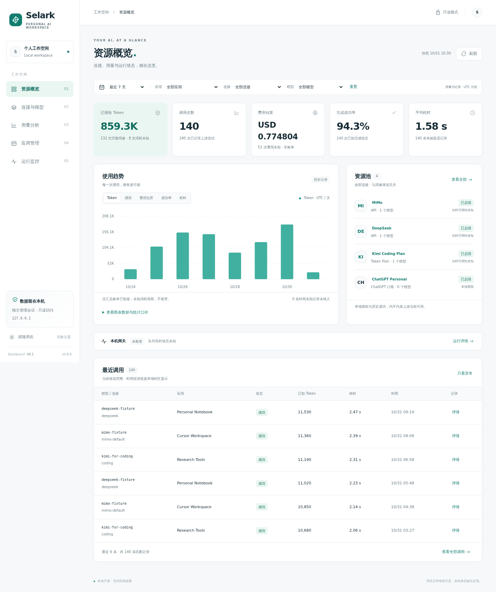

# Dashboard V0.1 验收记录

2026-10-31，Selark 0.8.0，Linux / Python 3.12.2。
机器可读结果见 [dashboard-verification.json](dashboard-verification.json)。

## 交付

`selark dashboard` 打开本地只读仪表盘；默认 `127.0.0.1:8790`，独立管理会话。
资源概览、连接与模型、用量分析、应用管理、运行监控五个页面均已实现。
界面支持深浅色主题、手机布局、可访问的控件标签、键盘操作、减少动画偏好、
时间 / 应用 / 模型 / 连接筛选、指标切换、图表数据表、调用分页和详情。

下图来自浏览器验收的**临时合成账本**，用于检查界面，不代表真实供应商能力或个人用量。
产品中没有演示模式、随机图表或内置示例数据。

## 回归与安全

- **656 项测试通过**，其中 **39 项 Dashboard 回归**；耗时 54.53 秒。
- 一条既有 Starlette / HTTPX TestClient 弃用提示，不影响结果，未调整既有运行依赖。
- Ruff 检查、格式检查、JavaScript 语法检查、`git diff --check` 全部通过。
- 独立管理身份验证：调用方令牌不能访问 Dashboard，管理会话不写磁盘；
  一次性链接过期 / 重用拒绝、会话过期、重启失效、登录限频、请求长度限制均已覆盖。
- 精确 Host / Origin、重复 Origin、Fetch Metadata、跨站 / 同站跨端口请求检查；
  拒绝业务 POST / PUT / PATCH / DELETE / OPTIONS，默认 HTTP 端口规范化通过。
- 旧 schema 不自动迁移；缺失配置不自动初始化；日志符号链接拒绝；
  API Key、OAuth 访问 / 刷新凭据、调用方令牌、摘要、原始错误正文和任意日志字段不外发。
- 校验零用量与未知用量、部分用量、矛盾计数、多币种费用、历史套餐零剩余与当前未知、
  有限 / 无限 / 未知配额、实际获准模型与授权开关的区别、撤销身份、分页和 SQL 参数绑定。
- 汇总与 CLI 核算一致；时间含开始不含结束，支持时区换算；成功率排除进行中 / 状态未知，
  无时间戳记录明确排除。健康响应只访问本机，并限制返回字段的类型。

## 浏览器与安装

Chromium 145 / Playwright 1.58.0 在真实本地 HTTP 服务上完成验收：

- 1440px 桌面和 390px 手机宽度；五个页面均无页面级横向溢出，宽表格在容器内滚动。
- 一次性登录、URL 片段清除、HttpOnly cookie、刷新后会话保留、未登录浏览器隔离。
- 深浅色主题与偏好恢复、五种图表指标、应用筛选、自定义空时间窗口、筛选重置、分页、
  连接 / 应用 / 调用详情、Escape 关闭、微小金额精度。
- **0 个脚本或控制台错误，0 个外部资源请求**。仅访问本机 Dashboard 地址。

通过 wheel 普通安装到全新独立 pipx 环境，确认包加载自 `site-packages`，
HTML / CSS / JavaScript / SVG 四项静态资源齐全；仓库外启动和已安装包浏览器验收通过。
wheel 与 sdist 均包含静态资源，`pip check` 无依赖问题，没有新增运行时依赖。

使用 **20,000 条含资源预留 / 价格的合成账本记录**进行安装后 TCP 检查，
第一次完整快照耗时 **2.996 秒**（本次机器测量，不是性能承诺）。
鉴权、脱敏、只读内容不变和退出均通过。Ctrl+C 沿用既有 CLI 退出码 130，属于正常取消；
验收子进程全部停止，不保留后台 Dashboard。

当前用户 pipx 安装已更新为 **Selark 0.8.0**，从仓库外可直接运行 `selark dashboard`。
另使用现有个人配置执行一次 `--offline` 的真实 Dashboard 只读访问，资源总览状态正常；
安装前后及查询前后 **163 份配置、OAuth、账本和备份相关文件内容哈希一致**。
共享内存、WAL、锁文件和运行日志不列入静态文件哈希比较。未触发真实模型调用、OAuth 刷新或供应商额度查询。

## CI 与范围

保留原工作区已有 CI 和验证脚本改动，新增：

- Python 3.11 / 3.12 / 3.13 安装后 Dashboard TCP 验收。
- Python 3.12 Chromium 页面、响应式、鉴权和交互验收。
- 独立锁定的浏览器验收依赖，以及合成截图 / JSON 结果 artifacts。

本次完成本地验证和 CI 配置，**没有触发远端 GitHub Actions**；其矩阵结果需以实际运行记录为准。
浏览器自动化覆盖 Chromium，未宣称已验证 Safari、Firefox 或 WSL 到 Windows 的所有网络配置。
没有修改 OAuth 实现、现有网关 API、连接、权限或数据库 schema。
未实现 SaaS、远程管理、智能路由、Agent、模型调用、服务控制或其他资源写入功能。
