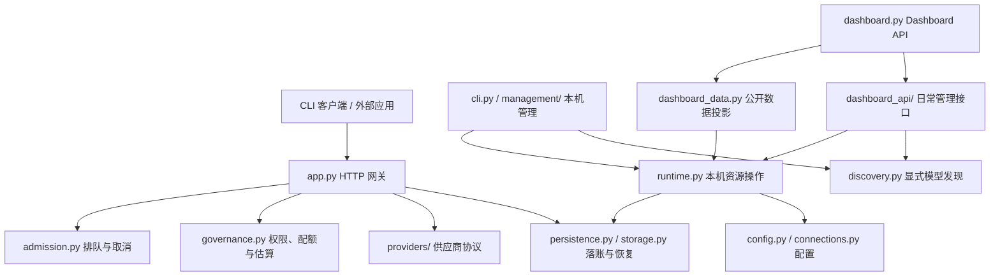

# 架构与模块职责

Selark 采用 Python `src/` 布局。可安装代码在 `src/selark/`，测试、维护脚本和文档留在仓库中；React 前端通过固定提交的 Git submodule 引入。这样普通 Python 安装不依赖开发目录和 Node 工具链。

[硬性设计原则与性能预算](design-principles.md) 约束所有模块和未来 Windows/macOS 版本：转发不引入 LLM 加工或提示文本；后台维持一个轻量核心进程，界面按需启动。

## 目录边界

| 路径 | 职责 |
| --- | --- |
| `src/selark/` | 网关、本机管理、配置、存储与恢复 |
| `src/selark/management/` | 管理命令的参数解析、执行、诊断、连接操作和订阅 CLI |
| `src/selark/providers/` | 各供应商协议、文本/function 转换及原生 Responses/Messages 转发 |
| `src/selark/dashboard_api/` | 日常管理的 HTTP 路由、请求结构和公开业务数据 |
| `src/selark/contracts/` | 公开响应字段、接口目录及离线 OpenAPI 导出；不参与运行时响应过滤 |
| `src/selark/dashboard_assets/` | 固定前端提交生成的 React 正式资源与校验清单 |
| `frontend/` | Selark-Web 子模块；Dashboard 页面源码，支持独立设计、模拟开发与正式构建 |
| `tests/` | 按领域命名的回归用例；`support/` 提供共享的合成响应与账本构造 |
| `scripts/` | 仓库检查、数据契约导出、进程验收和显式真实验收工具 |
| `config/` | 服务端、客户端和连接文件的占位模板 |
| `examples/` | 外部客户端示例、请求消息和应用策略模板 |
| `docs/` | `api/` 接口规范、`guides/` 使用说明、`development/` 开发约定、`verification/` 验收证据、`history/` 历史资料 |

## 请求路径与管理路径

图表示主要职责关系，不枚举每一次函数调用。`Runtime` 协调本机资源与配置变更，HTTP 网关负责请求生命周期；`providers/` 处理上游协议差异。
`providers/native.py` 仅在原生请求时加载，保留官方内容块和流事件；各入口共用同一鉴权、队列、配额与落账流程。工具执行和 Agent 循环留在调用方。
`persistence.py` 的恢复记录与异步写入、`storage.py` 的 SQLite 操作、`storage_schema.py` 的结构迁移分别维护。
`protocol.py` 提供有界 JSON 校验与响应关闭；网关、模型发现、套餐查询和各适配器共用关闭逻辑，统一保留取消屏蔽和两秒超时。

资源与转发约束：无待恢复记录时恢复协程等待事件；写入失败后才按一秒间隔处理有界批次，落账和故障恢复不调用模型。JWT/密码学依赖只在 OAuth 身份验证时加载。供应商适配仅转换协议所需字段，不注入提示词、补写历史或自动重发生成；配额估算始终留在本机。扩展适配器须保留这些约束，见 [资源占用与转发开销](../guides/efficiency.md)。

## 管理命令

`cli.py` 保留总入口、网关启动和客户端调用。`management/` 按职责组织：

| 模块 | 内容 |
| --- | --- |
| `__init__.py` | 保留既有 `selark.management` 函数入口 |
| `arguments.py` | 子命令声明、参数校验、查询过滤与策略输入 |
| `handlers.py` | 执行已解析的命令，将工作交给 Runtime 与所属服务 |
| `connections.py` | 交互连接配置、显式生成探测；发现复用 `discovery.py` |
| `diagnostics.py` | 配置、账本和本机健康诊断 |
| `chatgpt.py` | ChatGPT 订阅命令；授权实现仍在 `chatgpt_auth.py` |

监听地址的构造属于 `config.server_url`。Dashboard 数据、状态总览与后台服务直接使用配置层，不通过管理命令获取该能力。
新增业务能力优先放回领域模块；命令模块负责输入与呈现，避免再次集中成一个大文件。

## 界面与平台

当前 Dashboard 由 `dashboard.py` 提供同源 API 与 `dashboard_assets/` 静态文件，`dashboard_data.py` 只投影允许公开到页面的数据。React 源码在 `frontend/` 子模块；`scripts/build_dashboard.py` 将其正式构建与提交/hash 清单同步到包内，CI 校验二者一致。静态资源只开放清单内的文件，普通 Python 安装不需要 Node。
`dashboard_api/` 在同一管理会话边界内提供连接、模型和应用操作；复用领域模块，独立于页面实现。
应用写入使用只打开已有账本的模式，HTTP 管理不触发初始化或迁移。接口契约见 [日常管理 API](management-api.md)。
Selark-Web 中的 `DashboardApi` 把组件与模拟/HTTP 数据源分开。前端目录是独立 Git 仓库，改动和版本引用需要分别提交。

桌面版共享 HTTP / SSE 和管理契约，窗口与安装程序在独立项目维护。Windows Desktop 0.5.0 内置目录式 Python 后端，主进程通过私有管道启动 `desktop_session.py`；后者按需提供 Dashboard、复用或启动一个核心。续接管理会话不会重启核心，父进程退出通过管道 EOF 清理临时管理进程和自己拥有的核心；用户可明确选择保留核心，已有服务不接管退出。WSL 模式仍使用独立环境中的 Dashboard，双方运行数据分开保存。

桌面首次初始化使用无 Key、无模型、停用的空连接状态，配置不包含虚假的供应商 Key；连接列表不展示缺失的旧式默认连接。新增连接、发现、启用模型和创建应用仍通过原有管理 API，鉴权和账本结构不变。

后端 `platforms/` 根据当前系统选择底层实现，协议、权限、配额、SQLite 结构及恢复规则共用：

| 能力 | Linux / WSL | Windows 原生 |
| --- | --- | --- |
| 默认目录 | XDG 用户目录 | `%LOCALAPPDATA%\Selark` |
| 私有文件 | 所有者、0600 / 0700、O_NOFOLLOW | 受保护 DACL、句柄验证、拒绝重解析点 / 硬链接 |
| 跨进程锁 | flock | LockFileEx，进程退出释放 |
| 原子更新及刷盘 | 同目录替换、fsync | FileRenameInfoEx、文件和目录 FlushFileBuffers |
| 进程身份 | 用户、PID、启动时刻和 boot ID | 用户 SID、进程句柄及创建时刻 |
| 后台与退出 | systemd 或独立进程、SIGTERM | 独立进程、私有事件触发有界正常退出 |
| 登录启动 | systemd 用户单元 | 用户 HKCU Run 启动项，显式 enable / disable |

`windows_service.py` 的停止线程阻塞等待事件，不按时钟轮询。后台启动绕过 Windows 虚拟环境的重定向进程，保留虚拟环境依赖，使父进程观察的 PID 与实际核心一致。启动检查确认自身 PID 的健康接口，不向模型发请求。Windows 当前是用户级后台运行，不是 Windows Service；两边实例保存各自数据，不同时打开一份运行中的 SQLite 账本。

## 组织取舍

`app.py`、`runtime.py`、`storage.py` 仍是较大的协调模块。它们涉及请求清理、锁、事务和恢复顺序，后续拆分应围绕明确职责并配合行为回归。
其余规模较小、职责明确的领域模块继续保持浅目录；不为目录数量引入空的 `core/`、`common/` 或通用 `utils/` 层。

基础布局参考 [PyPA 的 src 布局说明](https://packaging.python.org/en/latest/discussions/src-layout-vs-flat-layout/)；测试环境与包外测试参考 [pytest 实践指南](https://docs.pytest.org/en/stable/explanation/goodpractices.html)。具体目录按 Selark 的维护边界选择。
