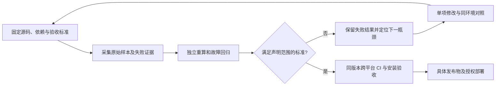

# 从单点优化到可验证的交付工作流

2026-11-09 的方案与首个最小闭环。所有阶段受 [硬性设计原则](design-principles.md) 约束；这是开发和验收流程，不给转发层增加模型调用、常驻服务或自动决策。

## Altitude：面向最终使用结果

根据项目定位和当前性能诉求，建议将目标定义为：**用户一次配置后，可以持续通过 Selark 在不同应用中使用明确选择的 AI 资源；响应开销低，权限和费用可控，记录可信，故障可恢复，更新有证据。** 这是待使用反馈修正的产品判断，不等于已经证明用户满意。

因此要同时回答三类问题：

| 层级 | 用户得到的结果 | 验收边界 |
| --- | --- | --- |
| 可信核心 | 每次生成有明确授权、明确资源、准确的已知/未知用量；失败不隐式重发 | 上游捕获、独立 SQLite 读取、撤销/配额竞态、崩溃重启 |
| 低干扰体验 | 首段与普通响应开销可预测；忙时有界排队，空闲低占用 | 固定机器的逐对测量、单独并发/大输入场景、CPU/RSS 与零扫描 |
| 可持续交付 | 新机接入、日常管理、升级和恢复都能独立复现 | 安装包外测试、前后端固定引用、浏览器流程、Windows/Linux CI |

现有 `app.py`、`admission.py`、`persistence.py`、`storage.py`、供应商适配器、Selark-Web 的数据边界，以及安装/恢复脚本已经覆盖大量行为。当前缺口是验收证据尚未形成一个完整的决策入口：CI 的性能采样是非阻断步骤，历史 Markdown 结论和单次中位数不能自动决定当前版本是否达到预算。

升级后的工作流：



自动化负责采集、复算、拒绝不完整证据和整理下一步依据；发布、收费调用、真实配置变更仍遵守具体授权。每项通过都附带适用场景，不能用“所有检查通过”代替用户旅程验收。

## Depth：采用原始证据与严谨方法

| 工作 | 原始资料和工具 | 方法 |
| --- | --- | --- |
| 定义用户可感知目标 | 项目预算、真实用户旅程；[Google SRE 的 SLO 方法](https://sre.google/workbook/implementing-slos/) | 将正确性、延迟、空闲占用分别验收，保留失效条件；新增用户体验阈值须先取得基线 |
| 判断优化是否有效 | `measure_relay.py` 原始逐对样本；[pyperf 的基准方法](https://pyperf.readthedocs.io/en/latest/run_benchmark.html) | 预热、新进程、相同解释器/依赖/环境，交替测量顺序；重复测量并展示每轮，禁止只选最好一次 |
| 定位必要开销 | `profile_relay.py` 的配置/线程/HTTP/持久化分段；需要时使用操作系统采样器 | 先区分 CPU、线程等待、网络和磁盘同步；探针结果不作为正式预算，不相加嵌套区间的 p95 |
| 保护持久性 | [SQLite WAL](https://www.sqlite.org/wal.html) 与 [synchronous 文档](https://www.sqlite.org/pragma.html#pragma_synchronous)；独立连接与故障注入 | WAL 的 FULL 提交包含同步保证；针对提交前后、收据更新/删除、客户端断开验证状态，不能通过降低同步等级获得数字收益 |
| 保护流式资源 | [HTTPX 异步流和关闭契约](https://www.python-httpx.org/async/#streaming-responses)、真实 TCP fixture | 既验证返回内容，也验证连接复用、尾部错误、取消和有界关闭 |
| 验证最终交付物 | wheel、`verify_stability.py`、`verify_operations.py`、浏览器与 GitHub Actions | 从源码目录外启动实际安装包；绑定前端引用与资源清单；外部 runner 运行相同回归 |

pyperf 的系统调优建议不能自动成为改变用户机器的授权。先记录环境与干扰因素；只有单独获准后才进行内核、CPU 亲和性或调频调整，并将其作为独立环境报告。

## Range：跨领域路径及采用顺序

1. **SRE 与实验设计**：使用事先定义的目标和停止条件管理优化。当前先把“测得更快”和“满足预算”分开，再补独立机器复现。三次通过只表示本组参考验收通过，不构成长期统计置信保证。
2. **排队论与容量管理**：单请求延迟之外，分别测量执行、排队、拒绝和取消；扩展现有多应用/128 客户端突发工具，观察长请求对其他应用的影响。不同请求成本不能只由 QPS 表示，参考 [SRE 的过载处理](https://sre.google/sre-book/handling-overload/)。Selark 的单次派发约束继续适用，不能照搬自动重试或投机请求。
3. **事务与状态机验证**：把“未派发、已派发、取得用量、交付中、已结算”作为跨 HTTP/文件/SQLite 的状态边界，沿用现有故障注入测试检查崩溃窗口。仅在证明相同恢复语义后，才评估减少持久化步骤或合并工作。
4. **人机交互与端到端体验**：将新机初始化、接入连接、启用模型、创建受限应用、首次调用、查看记录和恢复演练串成真实安装包旅程。人工任务成功率和完成时间另行记录；前端组件测试不能代替这个结果。
5. **架构与语言选择**：以分段测量确定瓶颈后，才比较 Python 局部优化与隔离的本地组件原型。若耗时主要来自必须保留的磁盘同步，重写语言本身不能消除这项工作。新增进程、队列或缓存必须同时报告延迟收益、常驻开销和失效语义。

优先顺序为：**证据闭环 → 普通响应尾延迟定位 → 并发与大输入体验 → 新机/升级用户旅程 → 有证据支持的架构实验**。当前不承诺未测量的亚毫秒或全负载目标。

## Verification：独立判定与失败条件

第一步落地为开发工具 `scripts/qualify_relay.py`，复用现有测量和恢复脚本，独立重算验收结果：

```bash
# Linux / WSL；需已经按 CONTRIBUTING 安装当前源码与锁定依赖。
# 目录必须尚不存在，既有证据不会被覆盖。
python -m scripts.qualify_relay --output reports/qualification/new-run

# 任意受支持的 Python 平台；离线、只读，不启动服务或重新采样。
python -m scripts.qualify_relay --check-evidence reports/qualification/new-run/evidence.json
```

入口固定执行：运行时约束 → 真实回环恢复 → 三个独立核心进程的参考批次。每批普通/SSE 各 300 对、预热各 5 对、空闲 30 秒。源码、实际加载的核心、脚本、依赖锁和实际依赖版本在每阶段前后核对；检查核心在仓库外的导入，防止旧安装冒充当前源码。允许开发环境的可编辑安装，此入口本身不构建 wheel，实际 wheel 的安装验收仍由完整 CI 执行。

| 判定项 | 通过标准 | 失败后的动作 |
| --- | --- | --- |
| 证据完整 | 五阶段齐全、成功退出、源码与环境一致、真实原始样本足量、摘要与复算一致 | 返回 2；保留部分证据，禁止称为预算通过 |
| 运行时约束 | 零额外/空闲生成、调用方文本保持、精确落账、健康空闲扫描 0、可选依赖按需加载 | 返回 1；先修正确性 |
| 恢复 | 既有九项 TCP/取消/退出/崩溃恢复检查全部通过，调用与用量对得上 | 返回 1；先修恢复 |
| 参考性能 | **每一轮**普通与 SSE 首段额外 p95 ≤ 10 ms，空闲 RSS ≤ 72 MiB、CPU ≤ 0.5% 单核 | 返回 1；报告每一轮未达标项，不以中位数豁免失败 |

只有上述四组全部通过才返回 0。流完成时间另报，不冒充首段指标。判定器不采用报告中的 `budget_checks` 或报告自行声明的放宽预算，而从带符号的逐对时延、CPU 时间和 RSS 复算；手算百分位、伪造通过标记、缺失样本、NaN、未知用量、混用源码、超时与清理反例进入常规 CI。

该入口只判定**单连接回环参考范围**。完整发布还必须核对同一源码/前端版本的跨平台 CI、API 契约、安装包和浏览器证据。当前判定器的源码和原始数据可由他人重跑，但这不等于第三方审计或对伪造整份输入的签名认证；真实性仍依赖受信的采样环境和外部复现。性能采样与功能 CI 的状态必须分别呈现。

## 权限、成本与边界

| 项目 | 本轮范围 |
| --- | --- |
| 可自主执行 | 仓库内工具/测试/文档修改、临时合成配置、回环服务、独立验收、既有授权下的 GitHub 提交推送和 CI 检查 |
| 进程权限 | 仅信号终止本次创建的独立进程组及其临时核心，超时先尝试清理再有界终止 |
| 需额外具体授权 | 真实供应商调用及费用上限、读取或修改个人配置、切换日常服务、真实数据迁移/删除、系统性能调优、部署发布物 |
| 模型成本 | 一轮闭环预计 3680 次合成上游处理；真实供应商请求为 0，供应商计费为 0 |
| 计算成本 | 每阶段执行超时分别为 45 / 90 / 120 / 120 / 120 秒；导入核验和清理另有超时。按本机 5–15 分钟准备，实际时间写入证据；GitHub CI 另消耗现有 Actions 配额 |
| 运行时成本 | 工具留在 `scripts/`，不进入 wheel；没有生产常驻任务、依赖、采集器或自动调用 |
| 停止条件 | 工具错误、超时、源码/环境漂移或证据缺失时停止后续采集并保存失败；性能超预算仍完成预定三轮，不自动重跑到通过 |

首个闭环的实测结果见 [验收记录](../verification/outcome-workflow-2026-11-09.md)。后续拓展必须沿用上述权限边界，不能把“自主工作流”解释为自动花费、自动重试生成或自行部署。

本次外部 CI 已实际发现一个本地未暴露的 Windows 验收竞态：重复创建 HTTP 客户端会消耗短排队窗口。先以合成客户端初始化延迟复现相同失败，再复用预建连接池并保留原有超时/拒绝断言。它说明外部验证还需审查测试器本身，不能把每次红灯直接归因于产品，也不能把重新运行变绿当作修复证据。
