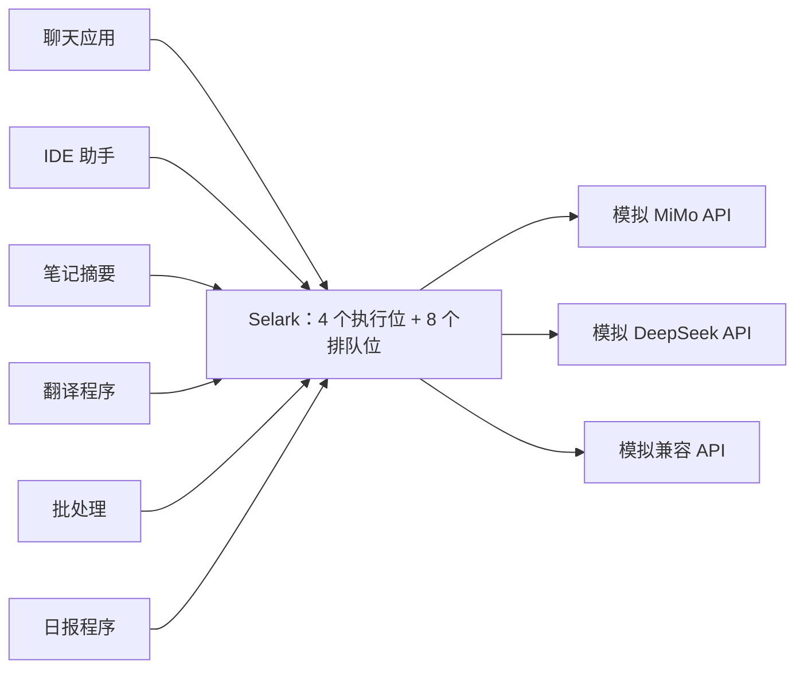

# 六应用并发模拟（0.7.2）

2026-10-30，当前用户的 pipx Selark 0.7.2；运行时没有改动。
六个独立应用各使用自己的令牌和 HTTP 连接池，经真实本地 TCP 访问隔离 Selark 服务。
上游是内存模拟：不读原配置、不接触真实 API Key，不连接供应商，不调用 OAuth。
原服务、WSL 和自启动设置不变。

本次完整运行 **702 个客户端请求、641 次模拟上游尝试、真实供应商请求 0 次**。
程序正常退出，12 组检查通过；检查包含预期拒绝和故障，不能把 702 都说成成功生成。
详细证据见 [JSON 记录](multi-app-simulation.json)，复现脚本见
[verify_multi_app.py](../scripts/verify_multi_app.py)。



## 各应用与账本

| 应用 | 独立调用方 | 模拟连接 | 全阶段请求数 | 已报告 Token |
| --- | --- | --- | ---: | ---: |
| 聊天 | `chat-desktop` | MiMo | 115 | 1,484 |
| IDE 助手 | `ide-helper` | DeepSeek | 113 | 1,484 |
| 笔记摘要 | `notes-summary` | MiMo | 116 | 1,456 |
| 翻译 | `translation-worker` | 兼容 API | 111 | 1,442 |
| 批处理 | `batch-indexer` | 兼容 API | 131 | 1,554 |
| 日报 | `daily-report` | MiMo | 116 | 1,470 |

正常负载阶段各发送 100 个请求，普通/SSE 交替，**600 个均完成并返回正确应用的唯一标记**。
全部故意使用相同 `session_id=shared-project`，查询仍得到六组会话，每组 1,400 Token。
每个成功模拟响应报告 10 输入 + 4 输出；SSE 故意重复累计用量帧，账本仍只计一次。
上述 Token 是虚构上游的测试数值，没有据此推算真实供应商费用或吞吐量。

正常负载与全局队列测试使用默认的调用方并发设置（不额外限制单个应用）；随后单独测试
每应用 1 或 2 个在途请求的限制。策略变化只发生在临时调用方，不改用户原权限。

## 实测行为

| 场景 | 观察结果 |
| --- | --- |
| 48 个请求突发 | 4 个执行、8 个排队；最终 12 个成功，36 个返回 `server_overloaded`，未进入上游 |
| 单应用并发上限 1 | 保持一个在途请求时，额外 10 个均被应用限额拦截 |
| Token 配额同时争用 | 4 个请求仅 1 个取得预留，另外 3 个拒绝；其他应用可用 |
| 金额配额同时争用 | 同样仅 1 个取得预留，另外 3 个拒绝；其他应用可用 |
| 越权连接 / 伪造调用方 | 分别返回 403 / 400，上游调用数不增加 |
| 同时注入六类故障 | 主动断连、上游 429、坏 JSON、SSE 缺结束、读超时、缺 usage；另一个健康请求完成 |
| 上游限流 | 保留 `Retry-After: 2`；不自动重试，也不切换连接 |
| 未知消耗 | 仅阻止对应有本地 Token/费用限额的应用继续生成，保留未知预留 |
| 撤销一个临时应用令牌 | 该应用返回 401，其他应用继续成功；不是供应商 OAuth 退出 |
| 停止并重启临时实例 | 各应用汇总及未知预留不变，恢复不生成内容、不重复记账 |

每条已记录请求的调用方与实际鉴权一致，上游尝试数合计等于模拟出口计数，单请求最多一次尝试。
最终 active、queued、admitted、pending 和 interrupted 均为零；临时服务、假凭据和账本已清理。

## 两个需要明确的边界

**完整响应收到后，并发名额不一定已释放。** 服务还需要保存最终交付结果。
在并发上限 1 的立即连续请求实验中，10 个不同请求有 9 个成功、1 个得到
`caller_concurrency_limit`。更早的冒烟也在这个窗口观察到 429。
这是当前“在途包含最终落账”的语义，不是重复生成或账本丢失；没有为了让测试全成功而加入自动重试。
持续交互的应用可按需求给自身留出两个名额，并在界面中明确提示限流状态。

**应用限额不提供全局容量的独占保障。** 全局入口先限制总请求数；即使某应用的请求被拒绝，
拒绝结果落账时也会暂时占用全局名额。在 10 个批处理请求被应用限额拒绝后立即发送其他应用请求，
五个邻居中两个成功、三个得到全局过载 429。待这些拒绝记录清理完毕，在批处理原请求仍占一个
执行位的情况下，五个邻居的新请求全部成功。

因此目前具备权限与账本隔离、每应用限制和有界全局排队，但没有每应用保底容量、优先级队列
或严格公平调度。突发请求可能短暂影响邻居；本报告保留了这一结果。
若下一阶段要改善这一点，应先考虑收尾名额与执行名额的区分，以及有界的应用公平准入，
同时保留落账和未知费用保护；本轮没有直接改变这些运行时语义。

## 性能口径与复现

本机本轮成功交付耗时 P50 116.58 ms、P95 149.66 ms，最大 518.33 ms；
155 次健康采样全部成功，P95 63.62 ms，最大 64.70 ms。
包含测试刻意增加的模拟延迟、本地排队、SQLite 和日志操作，不能当作真实模型延迟或容量承诺。

```bash
# 使用已安装 Selark 的解释器；此命令没有真实模型消耗。
/absolute/pipx/venvs/selark/bin/python scripts/verify_multi_app.py \
  --requests-per-app 100 --output /tmp/selark-multi-app.json
```

GitHub Actions 的 Python 3.12 作业加入同一六应用场景，使用模拟上游和临时目录。
既有 Python 3.11/3.12/3.13 回归、四资源并发、进程恢复及操作验收继续保留。
