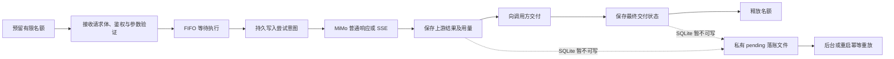

# Selark 0.3：单机稳定性与恢复

适用范围仍为 WSL/Linux、本机单实例、HTTP API + CLI、一个 MiMo 连接。
原来的三个接口、客户端配置、调用方令牌和会话归组继续兼容。新增运行限制可用
`selark limits show --json` 查看；缺少 `limits` 的旧配置自动使用默认值，无须重建凭据。

## 并发与超时

```bash
selark limits show --json
selark limits set --max-concurrent-requests 4 --max-queued-requests 16 \
  --queue-timeout-seconds 10 --request-timeout-seconds 120
# 修改后重启 selark serve 生效
```

运行限制保存在服务配置的 `limits` 对象中，启动时固定。连接地址、Key、模型与启停仍按原规则热生效；
修改本地运行限制不改变连接指纹，不使真实探测结果过期。

| 字段 | 默认值 | 含义 |
| --- | ---: | --- |
| max_concurrent_requests | 4 | 同时占用执行名额的请求，包含模型调用、交付与落账收尾 |
| max_queued_requests | 16 | FIFO 执行等待名额；总接纳数最多两项之和 |
| queue_timeout_seconds | 10 | 已验证请求等待执行名额的上限 |
| request_timeout_seconds | 120 | 从进入 HTTP 处理到终止响应交付的取消预算 |
| body_timeout_seconds | 10 | 接收完整请求体的上限，仍最多 1 MiB |
| connect_timeout_seconds | 10 | 建立上游连接的等待上限 |
| pool_timeout_seconds | 5 | 等待上游 HTTP 连接池的上限 |
| write_timeout_seconds | 10 | 上游请求写入空闲超时 |
| send_timeout_seconds | 15 | 每次向下游发送响应头/数据的等待上限 |
| shutdown_grace_seconds | 15 | 正常关闭时等待已接收请求结束的宽限 |
| storage_busy_timeout_seconds | 0.1 | 服务端每次 SQLite 锁等待上限 |
| max_pending_records | 256 | 待落账文件达到此数时停止接纳新生成 |

原顶层 `timeout_seconds` 继续表示**上游读取空闲超时**，默认 60 秒。
因此，持续产生少量文本的流也会在总时限到达时取消，不能靠不断输出无限延长请求。
总时限是取消预算；取消后还要关闭连接、完成正在执行的短存储操作和保存状态，收尾可能额外耗时。
普通响应或终止 SSE 事件已成功发送后，资源关闭不会再附加一个总时限错误。

进入服务时先预留总名额，因此接收请求体、鉴权和排队本身也有数量上限，不会创建无限后台任务。
鉴权及参数验证后进入 FIFO 队列，取得名额后再写入尝试记录、发送上游。
慢请求体也占总名额；排队取消和超时会归还名额。上游连接池最多保留与执行名额相同数量的连接。
模型列表等鉴权查询另有 8 个本地处理名额；`/health` 不等待 SQLite。
Uvicorn 还设置了连接处理限制、128 的监听 backlog 和 5 秒 keep-alive；这不是面向公网的抗洪泛服务。

| 情况 | 响应 | 新的上游生成 |
| --- | --- | --- |
| 执行与等待总名额已满 | 429 server_overloaded，Retry-After: 1 | 无 |
| 等待执行名额超时 | 503 queue_timeout，Retry-After: 1 | 无 |
| 请求体接收超时 | 408 request_body_timeout | 无 |
| 连接停用 | 503 connection_disabled | 无 |
| 分发前 SQLite 不可写 | 503 local_state_unavailable | 无 |
| 落账故障或积压达到上限 | 503 record_storage_unavailable | 无 |
| 上游连接/连接池/写入超时 | 504 upstream_connect_timeout / upstream_pool_timeout / upstream_write_timeout | 不自动重试 |
| 上游读取空闲超时 | 504 upstream_timeout | 不自动重试 |
| 请求总时限 | 504 request_deadline_exceeded | 不自动重试 |
| 下游发送失败/超时 | 通常已不能交付新错误响应；本地记录原因 | 不自动重试 |

SSE 已开始后不能改变 HTTP 状态；可交付时发送 `event: error`，不发送成功 `[DONE]`。
`Retry-After` 是调用方的退避提示，Selark 不据此重试生成，也不承诺请求幂等。
若调用方自行重发，就是另一个逻辑请求，应自行评估前次是否已产生消耗。

## 请求生命周期和记录口径



新增记录字段：

- `upstream_result`：not_started、in_progress、success、failed、cancelled 或 unknown。
  普通 JSON 完整验证通过，或有效 SSE 收到 `[DONE]`，才表示上游成功。
- `delivery_status`：pending、sent、failed、disconnected 或 unknown。
  sent 表示 ASGI 发送成功，不代表对端应用已消费内容或完成自己的业务落库。
- `upstream_error_code`、`delivery_error_code` 分别保留两端的失败原因；`queue_ms` 记录等待名额耗时。
- 原 `status` 继续表示整次请求的最终状态；`http_status` 保留已选择/发出的 HTTP 状态，
  因而流式响应可能 HTTP 200 但请求状态 failed。

例如：MiMo 已返回 14 tokens，而最后一次下游发送失败，则记录为
`upstream_result=success`、`delivery_status=failed`、`status=failed`，真实 14 tokens 仍计入汇总。
请求日志与数据库使用相同最终状态计算；生成成功不再提前等同于交付成功。
交付前的持久检查点可能短暂显示 running，但上游结果和已取得用量已经保留。

用量规则保持兼容：缺失为 null，合法零值为 0，不估算、不推导字段；流式累计片段替换而非相加。
只有取得完整上游结束标记，流式用量才进入最终计数；未完整结束的流保留已观察到的
`reported_usage`，计数仍未知。正常完成后发生下游失败不会清除已取得的最终用量。
多轮仍逐次采用上游报告量，不对重复上下文去重。日期筛选默认 UTC，国内自然日加 `--tz Asia/Shanghai`。

`upstream_attempts=1` 表示已记录发送意图并尝试发送，不是供应商确认收到或计费的证明。
异常退出可能发生在预写尝试与网络发送之间，不能据此补造用量或自动补发。
本版本没有模型重试，一个逻辑请求最多一次发送尝试。

总名额已满，或落账存储已停止接纳时，拒绝只写请求日志，不继续创建新的落账文件，避免拒绝流量填满磁盘。
其他已接纳的本地失败尽量保存元数据，`upstream_attempts=0`；这不表示发生了模型消耗。
进程在接收/鉴权/排队期间被强制终止时，尚未分发的记录可能尚未写入；不会因此重发生成。

## 断连、撤销与关闭

普通和流式请求都在收到完整请求体后监听下游断开，覆盖排队、等待上游响应头、生成和交付阶段。
断开时取消尚未完成的上游等待并关闭响应；已经取得的用量保留，未取得的部分保持未知。
断开或本地取消不保证供应商立即停止计算，Selark 不推测供应商最终消耗。

调用方身份仍只由鉴权决定。已通过鉴权的在途请求（包含已进入队列者）沿用该身份；
撤销不会中断它们，撤销后新鉴权的请求被拒绝。连接配置在真正分发前重新读取，
停用会阻止仍在排队的请求发送上游；已经准许发送的调用继续。

`Ctrl+C` / SIGTERM 停止接纳新连接，并等待宽限；超过宽限的请求被取消、归还资源，
记录为 interrupted/service_shutdown，保留已取得用量。正常请求有机会在宽限内完成。
SIGKILL 无法执行清理；重启先重放落账，再将遗留 running 标为 interrupted。
服务不会因为取消、退出或重启而自行生成替代请求。

## SQLite、落账文件与恢复

服务侧 SQLite 操作在单独的有限工作线程中执行，短 busy timeout 限制写锁等待。
普通令牌鉴权使用读取事务；一次性探测凭证仍以原子条件更新消费。
落账文件另用一个 I/O 工作线程，不逐文本片段写 SQLite；管理 CLI 在各自进程中访问数据库。

数据目录下 `pending/` 使用 0700，每个 JSON 文件使用 0600，按请求 ID 保存必要元数据；
不保存消息正文、答案、Authorization 或 MiMo Key。
上游结束时原子写入并 fsync 文件与目录，交付结束后更新最终状态。
SQLite 成功落账后才移除最终文件；后台每秒最多重放 8 条已结束记录。
正在交付的检查点不会被后台提前判为中断。

重放按请求 ID 更新同一行，并以修订顺序阻止旧检查点覆盖新交付状态，绝不把累计值再加一遍。
积压到上限时拒绝新生成；已经接纳的有限请求仍可保存收尾，因此极端情况下文件数可高于阈值，
但额外部分受总接纳名额约束。重试仅限本地落账，不会请求 MiMo。

```bash
selark doctor --json
selark records list --limit 20 --json
# 停止服务后：
selark records recover --json
selark serve
```

`doctor` 检查配置、SQLite 完整性/版本/短写锁、待恢复文件和服务健康；不生成模型请求。
`records recover` 需要获得同实例服务锁，不能与运行中的服务同时重放。
损坏或权限不正确的落账文件原样保留并报告，启动会停止，避免默默丢弃已知消耗。
管理员应检查受保护备份及错误原因，不应直接删除不了解的待落账记录。

如果数据库和落账文件同时不能写入，服务保留可返回的结果、输出带实际用量的
`record_write_failed` 日志并停止接纳新生成。没有成功持久化的用量不能凭空恢复；
需要核对日志，未知记录不能当作零。`/health.storage` 显示异常、待落账数量和是否继续接纳。

## 兼容升级与边界

升级前停止旧服务，使用原配置重新安装并运行 `selark migrate` 或 `selark serve`。
SQLite 从版本 1 升级到 2 前，在原数据目录 `backups/` 创建受保护配置与数据库备份；
旧服务持有服务锁时拒绝升级。新增列在历史记录中保持未知，旧令牌及撤销状态不变。
迁移事务失败会整体回滚，可重新执行；重复启动不重复导入历史、不重复统计。

探测结果改为按连接和配置指纹分别保存，同一配置按探测开始顺序决定最新结果。
旧配置的迟到结果保留为历史验证，不会覆盖当前配置成功状态；落账重放也遵守同样规则。
升级保留既有连接指纹，增加本地运行限制不会使原验证凭空过期。

备份也保留当时可见的 pending 文件。恢复时先停服，再恢复同一套配置、数据库及落账文件，
不要覆盖运行中的 SQLite/WAL。回退旧程序必须恢复对应旧版本数据库；不能让 0.2 打开已升级的库。

本轮不包含多机队列、跨实例限流、客户端幂等键、自动金额估算、日志轮转或对话上下文管理。
正常磁盘和操作系统可用是持久性前提：强制退出发生在上游结果到达与首次持久化之间，仍有信息丢失窗口。
Python 无法安全强杀正在执行内核文件 I/O 的线程；超时不保证故障磁盘上的 fsync 立即返回。
当前只对 WSL/Linux 的个人本机服务进行验证，不提供跨机器或公网高并发承诺。

协议依据：[HTTPX 分阶段超时](https://www.python-httpx.org/advanced/timeouts/)、
[ASGI HTTP 交付与断连](https://asgi.readthedocs.io/en/latest/specs/www.html)、
[SQLite WAL 并发说明](https://www.sqlite.org/wal.html)。
